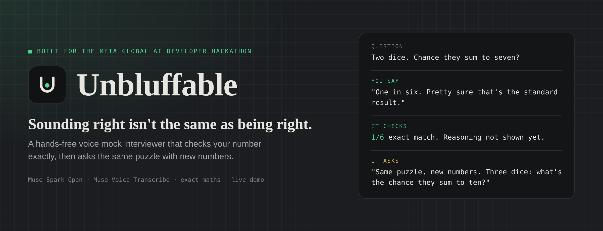
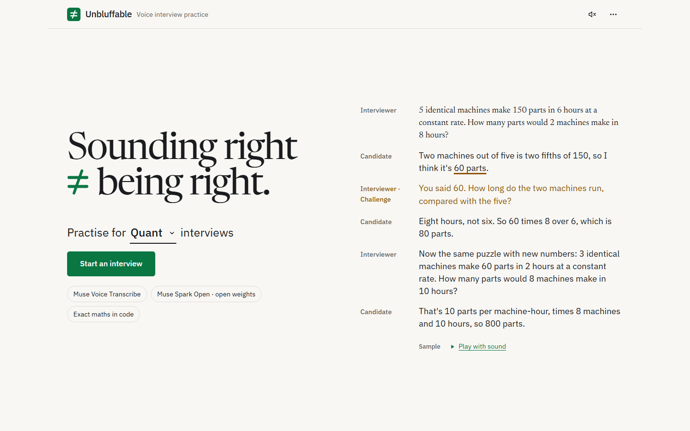
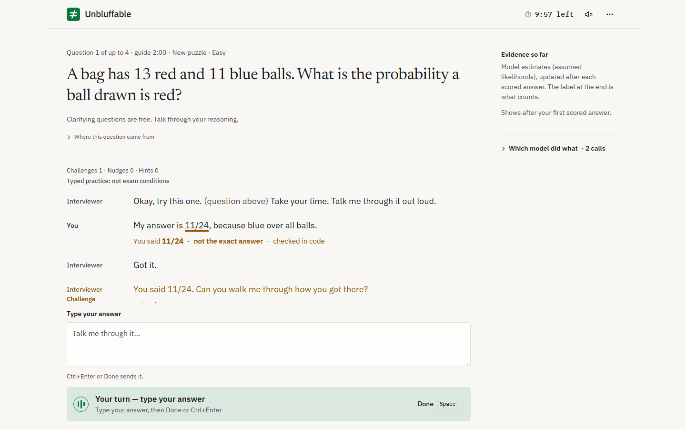
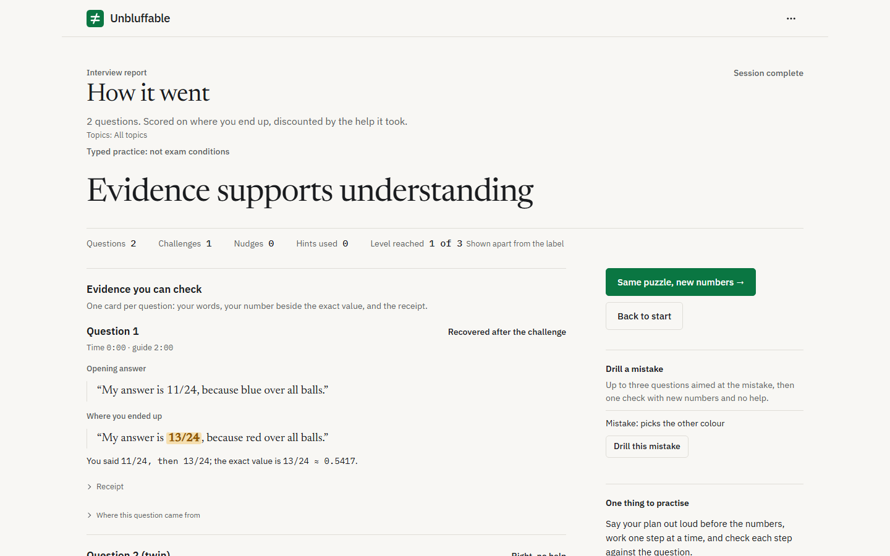
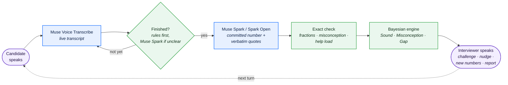
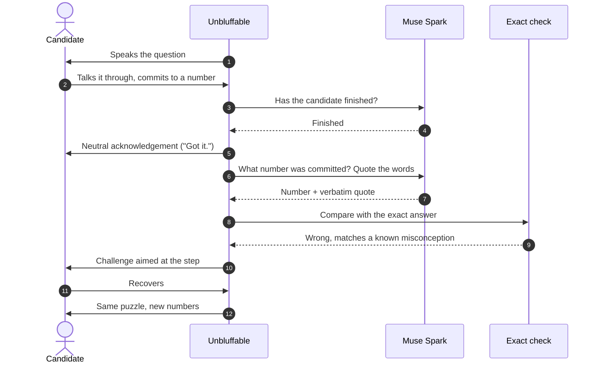

<div align="center">



# Unbluffable

A spoken mock interviewer that hears your answer, quotes your words back,<br/>
checks your numbers exactly and pushes back like a real interviewer,<br/>
so anyone can know what the room feels like before they're in it.


[](https://github.com/chisom-OOO/unbluffable/actions/workflows/tests.yml)

**▶ Live:** https://unbluffable-ptz1.onrender.com (laptop or iPad, Chrome or Safari, allow camera and mic; first load can take ~30 s)<br/>
**▶ Demo video:** [Watch the 2:10 demo on YouTube](https://youtu.be/tIcNkskoIRM)<br/>
**▶ Public question dataset:** [600 numeric questions · 12 families · Hugging Face](https://huggingface.co/datasets/unbluff/unbluffable-numeric-interview-questions)

[Try it](#try-the-interview) · [How it works](#how-it-works) · [Meta models](#meta-models-used) · [Evidence](#measured-so-far) · [Public artifacts](#open-artifacts-on-hugging-face) · [Run locally](#run-it-locally)

</div>

---

## Try the interview

Voice mock interviews for quant, banking, consulting and software roles. Practise answering aloud, responding to a challenge and explaining your answer with new numbers.

1. Open the [live app](https://unbluffable-ptz1.onrender.com) and press the sample replay on the landing page.
2. Start a quant interview, allow camera and mic, and give a wrong number on purpose. Typed practice is also available.
3. Listen to the interviewer question that number, then answer the same puzzle with new numbers. Open the receipt and report to see your quoted words, the numerical check and what to practise next.

**The numeric interview loop:** spoken answer → quoted commitment → check in code → targeted challenge → same puzzle with new numbers → practice report.

### At a glance for judges

| Criterion | What to inspect | Evidence |
| --- | --- | --- |
| **Impact** | Interview practice for candidates without a coach or network; four tracks, including behavioural questions | [Why](#why), [features](#what-it-does), [live app](https://unbluffable-ptz1.onrender.com) |
| **Meta tooling** | Muse Voice Transcribe for speech; Muse Spark Open on Baseten for hosted reasoning; Muse Spark 1.3 as an alternative backend | [Model roles and implementation](#meta-models-used) |
| **Technical depth** | Fraction arithmetic, quoted-answer receipts, help accounting, record/replay and automated tests | [Architecture](#how-it-works), [measured results](#measured-so-far), [decision log](spec/DECISION_LOG.md) |
| **Demo** | Live interviews, sample replays, report and question upload | [Live app](https://unbluffable-ptz1.onrender.com), [screenshots](#screenshots), [bring your own question](#bring-your-own-question) |

**Evidence boundary:** the existing comparison did not establish superiority over a carefully prompted chatbot. The public dataset's 600 answers were recomputed exactly; this does not establish improved interview performance. [Results and limitations](#measured-so-far).

> [!NOTE]
> **Prior work.** The specification in `spec/` was written before kickoff as a plan. All code was written after kickoff on 26 Oct 2026, and the commit history shows it. Built with AI coding assistants (Claude Code, Codex, Muse Code). More in [Disclosures and limits](#disclosures-and-limits).

## Why

I struggled in interviews. Not because I didn't know the material, but because I'd never been in the room: never had someone stop me mid-answer, question the number I'd just committed to, and ask it again with different numbers.

Some candidates get that practice through coaches, paid prep or people who've been through it. Most don't. They find out what a real interview is like by sitting one.

I started building this for quant interviews, my own field. But the problem isn't quant. Banking, consulting and software interviews work the same way: you think out loud, commit to an answer, and get pushed on it. Quant, investment banking, consulting and software engineering are all live.

**It's the interviewer you'd have if you had the connections.** Built for the theme **Build for Your World**.

## Screenshots

| Landing | Interview room, mid-challenge | Report |
| --- | --- | --- |
|  |  |  |

<sub>Taken from the local app in replay mode, with no key. The room and report show a scripted session from the test suite, not a real user.</sub>

## How it works



<sub>Purple: people · Blue: Meta models · Green: our code</sub>

One answer, start to finish:



- **Turn-taking.** After a short pause, deterministic cues decide first ("that's my answer", a trailing "so…"), and only unclear cases go to the model. If you go quiet for about 8 s, a fast check ends the turn if you've committed to a number, and otherwise asks you to talk it through.
- **Help accounting.** Each hint or nudge is scored by how many solution steps it gives away beyond where you already were (help load H). A correct answer after help counts for less: its evidence weight is w = 2 / (2 + H), and needing a challenge counts as one more step ([spec/02 §7](spec/02_ENGINE_SPEC.md)).
- **No model grades a number.** Models extract and phrase; code computes. A quote is kept only if it appears word for word in your transcript.

## Meta models used

**Hosted flow:** microphone → Muse Voice Transcribe → Muse Spark Open on Baseten → numerical check in code → browser speech synthesis. Spark 1.3 and Spark Open are alternative reasoning backends. Code checks the extracted numerical answer with Fraction arithmetic and explicit rounding/tolerance rules; models interpret the reasoning.

**Implementation:** [Meta and Baseten clients](llm/client.py), [reasoning backends](llm/backends.py), [speech provider](voice/provider.py), [numeric checker](engine/checker.py). [Integration evidence and tests](docs/meta-integration-evidence.md).

| Model | Runs on | Job |
| --- | --- | --- |
| **Muse Voice Transcribe** · `muse-voice-transcribe-1.0` | Meta Model API, realtime | Live speech-to-text for the hands-free interview |
| **Muse Spark** · `muse-spark-1.3` | Meta Model API | Extracts the committed answer and verbatim quotes, judges whether an answer is finished, judges behavioural answers (local runs). For Bring your own question (local runs), reads the uploaded image or pasted text into the question text (image input, strict JSON schema; it is not asked to solve it) and writes the second, independent solver that checks it |
| **Muse Spark Open** · `meta-models/muse-spark-open-1026` | Baseten (open weights) | Every reasoning call on the hosted app (`LLM_BACKEND=open_weights`), including judging behavioural answers and, for Bring your own question, reading the uploaded image and writing both of its checks (a solver and, in a separate call, an exhaustive simulation). In local runs it writes a BYOQ question's template, solver and wrong methods, all run in a sandbox, never in the web process. Offline, it wrote each question family's solver, wrong-method values and coding tests: a solver written from two worked examples, then run on every variant. A family ships only if its solver reproduces every stored answer in code. The questions, variants and stored answers were generated with ChatGPT, except the 30 Easy quant families (`qe_`), written by Claude |
| **Exact maths** | Our code | Every number check and every score |

### Why open weights

The hosted app runs on Muse Spark Open because, from our cloud host, Meta's API showed no Muse Spark models for our key: `GET /v1/models` returned HTTP 200 with an empty list, while the same key from a UK connection listed 9 models. Moving every reasoning call on the hosted app to Muse Spark Open kept it deployable. Transcription stays on Muse Voice Transcribe.

| Parity check | Muse Spark 1.3 | Muse Spark Open (Baseten) |
| --- | --- | --- |
| 10-case latency probe, median (max) | 0.98 s (1.90 s), minimal effort | 1.59 s (3.95 s) |
| Same commitment and number as Muse Spark, 10 cases | — | **10 / 10** |
| Run 1, Unbluffable's correct verdicts (below) | 34 / 40 | 35 / 40, no verdict changing across runs |

## Measured so far

| What | Result |
| --- | --- |
| **Interrupting mid-sentence** with realtime keyword rules | 2/10 wrong answers caught on the initial gate. Rules widened from the failure types reached 8/10 on those clips but **1/10 on 30 new held-out clips**, with 0/20 false challenges in both runs. We dropped it for a challenge right after the answer ([decision log](spec/DECISION_LOG.md) rows 1–1b). |
| **End-of-answer detection** on 60 recorded clips | **0 early cut-offs.** 32/60 completed exactly once; every miss was the app waiting too long, never interrupting. A silence check was added afterwards (rows 11–12). |
| **Last word to spoken acknowledgement** | About 2 s in a timed run, most of it one Muse Spark call |
| **Question families shipped** | **305** of 316 families attempted (decision log rows 19, 21–22, 30 and 45) across four tracks (159 quant, 18 quant developer, 60 investment banking, 30 consulting, 38 software engineering), 50 or 75 variants each, plus 54 coding specs. Easy families per track: 38 quant, 4 quant developer, 12 investment banking, 6 consulting, 9 software engineering. For each family Muse Spark Open wrote a solver from two worked examples; the family ships only if that solver reproduces the stored answer on every variant (300 exactly, 5 within the stated tolerance). Families that missed any variant were not shipped, e.g. 2 of the 101 in the main quant pack. 254 families also have wrong-method values verified in code, which the interviewer uses to name a misconception. |
| **Automated tests** | 1,400+ (pytest, 1,492 in the last full run), including pinned values for the engine maths and a test that every track and format moves on after each answer, plus eight Node suites for the browser logic |

Every change from the original plan is in the [decision log](spec/DECISION_LOG.md), with the evidence that forced it, including what failed.

### Comparison against a carefully prompted chatbot (run 1)

Run 1 used frozen, model-written transcripts: every arm saw both the original and the new-numbers answer, and the bluffs were easy, so it could not test the live challenge.

Pre-registered and frozen before any model saw it ([decision log](spec/DECISION_LOG.md) rows 15, 31, 32; items in [`eval/items_draft.json`](eval/items_draft.json), sha256 `b9aeb7f1`). 40 answer pairs (an original question and its new-numbers twin): 15 correct, 10 recited from memory, 10 confident misconceptions, 5 arithmetic slips. Every arm saw the same transcripts, three runs each.

**Pre-registered headline:** Unbluffable 34 / 40 against a carefully prompted Muse Spark given the verified answers, 35 / 40. No significant difference.

| Arm | Correct verdicts | False flags on answers that show understanding |
| --- | --- | --- |
| Plain Muse Spark 1.3 | 39 / 40 | 5% |
| Carefully prompted Muse Spark | 34 / 40 | 25% |
| Carefully prompted, given the verified answers | 35 / 40 | 25% |
| **Unbluffable** (Muse Spark) | 34 / 40 | 30% |
| **Unbluffable on Muse Spark Open** | 35 / 40 | 25% |

**What it shows.** No arm is significantly better than another (exact McNemar, smallest p = 0.0625). Every arm caught every recited and every misconceived answer: the bluffs in this set were too easy to spot, because 39 of the 40 transcripts were written by a model (Claude) and give themselves away. The arms differ only on the five arithmetic slips, which Unbluffable marks as not yet shown in a frozen transcript; in a live interview it would challenge the number instead. One item labelled correct (e05) was scored Vague by Unbluffable. Replaying the recorded calls showed this was not a bug: the answer (22) was extracted correctly, but the item's transcript only read out the question's own figures before the number, with no reasoning, and Unbluffable codes a right number without supporting reasoning as Vague by design. The flaw is in that model-written item. Muse Spark Open coded the same reasoning as valid, so the open-weights arm scored it Correct. Unbluffable on open weights matched Unbluffable on Muse Spark, with no verdict changing across runs.

**What it doesn't show.** It doesn't test the live interview, where Unbluffable picks numbers that expose a suspected mistake and challenges the number you commit to.

### Exploratory, not pre-registered (row 47); 39 of 40 items model-written

This is a follow-up on the same frozen run-1 items (sha256 `b9aeb7f1`), 3 runs. We registered it in the [decision log](spec/DECISION_LOG.md) (row 47) before any call, but not in advance like run 1, so treat it as exploratory. It compares one prompt on one model, Muse Spark 1.3, and does not stand for chatbots in general. The carefully prompted Muse Spark arm saw only the first answer. Unbluffable saw the first answer and the new-numbers answer. Full output: [`eval/exploratory/results.md`](eval/exploratory/results.md).

| Category | Items | Careful Muse Spark, first answer only | Unbluffable |
| --- | --- | --- | --- |
| Recited | 10 | 10 / 10 flagged | 10 / 10 flagged |
| Misconception | 10 | 10 / 10 flagged | 10 / 10 flagged |
| Arithmetic slip | 5 | 5 / 5 flagged | 5 / 5 flagged |
| Correct | 15 | 14 / 15 flagged | 1 / 15 flagged |

- **Recited items:** both arms flagged all 10.
- **The 15 correct items:**
  - Careful Muse Spark, first answer only, flagged 14, and its verdict changed across runs on 5 of the 40 items (4 correct items and 1 arithmetic slip).
  - Unbluffable flagged 1 (e05, the flawed item described above), with no verdict changing across runs.
  - Exact McNemar on the majority verdicts: 13 items flagged by the careful arm only, 0 by Unbluffable only, p = 1/4096 ≈ 0.00024 (exploratory, uncorrected).
- **Caveat:** the careful arm flagged 39 of 40 items overall, so its 10 / 10 on recited items says little about telling recited answers apart. The two arms also saw different evidence: one answer against two.

Run 2 (pre-registered, decision log row 34): not run, because no testers were available before the deadline.

## Open artifacts on Hugging Face

The public question corpus and its validation tools are available on Hugging Face:

- **Question dataset:** [Unbluffable Numeric Interview Questions](https://huggingface.co/datasets/unbluff/unbluffable-numeric-interview-questions) — 600 synthetic questions across 12 families, covering quant, investment banking, consulting and software engineering.
- **Offline answer validator:** [Python validation script](https://huggingface.co/datasets/unbluff/unbluffable-numeric-interview-questions/blob/main/validate_dataset.py) — recomputes answers from question parameters using exact Fraction arithmetic.
- **Published validation results:** [Validation report](https://huggingface.co/datasets/unbluff/unbluffable-numeric-interview-questions/blob/main/validation_report.json) — all 600 released answers passed exact recomputation.
- **Provenance and limitations:** [Dataset card](https://huggingface.co/datasets/unbluff/unbluffable-numeric-interview-questions/blob/main/README.md) and [source manifest](https://huggingface.co/datasets/unbluff/unbluffable-numeric-interview-questions/blob/main/manifest.json) — generation attribution, source hashes, licensing and scope.

### Release details

[Unbluffable Numeric Interview Questions on Hugging Face](https://huggingface.co/datasets/unbluff/unbluffable-numeric-interview-questions) contains **600 questions from 12 families**, with 150 questions each for quant, investment banking, consulting and software engineering. It is an MIT-licensed subset of the public question bank, pinned to source commit `5db4b18`.

The release includes question text, parameters, exact answer strings, recorded wrong-method values, source-model and verification metadata, a dataset card, source hashes and an offline Python validator. **All 600 released answers were recomputed exactly from their parameters** using the included validator. The [published validation report](https://huggingface.co/datasets/unbluff/unbluffable-numeric-interview-questions/blob/main/validation_report.json) records the result.

The questions were generated with ChatGPT, except the selected `qe_` families, written by Claude, as disclosed above. Muse Spark Open wrote the original family solvers. The release validator was prepared with Codex and recomputes the selected answer formulae. Source review labels, including `pending_builder_review`, are preserved. Wrong-method explanations remain source annotations; the release check verifies that their numeric values differ from the correct answer.

This is a public, synthetic question corpus with related variants and no held-out evaluation split. It contains no candidate answers or recordings. Its numerical checks do not establish interview improvement or validate a candidate's reasoning. See the [dataset card and limitations](https://huggingface.co/datasets/unbluff/unbluffable-numeric-interview-questions/blob/main/README.md) and [release details](docs/dataset-release.md).

## What it does

| | |
| --- | --- |
| **Four tracks** | Quant, investment banking, consulting and software engineering, each with its own topics and the same interviewer. |
| **Behavioural questions** | For banking and consulting: "tell me about a time…" and "what would you do if…". Your STAR funnel is filled with your own quoted words, the interviewer probes the weakest step, and your follow-up is checked against your first telling. Model-judged, and labelled that way. |
| **Hands-free spoken interview** | One tap starts it. The interviewer speaks, you talk it through, and the app decides you've finished from what you said, not from a fixed pause. The interviewer's voice is your browser's built-in speech synthesis. A silence prompt and an optional Done button are fallbacks. Camera and microphone are on, as in a real interview; a typed practice mode is there for anyone who can't use them, labelled *not exam conditions*. |
| **Exact checking** | The model extracts the answer you committed to and quotes your own words. Every number is checked with exact fractions in code, never by a model. |
| **Challenge on the step** | A committed wrong answer gets a question that points at the step, not the solution. Nudges and hints are allowed, and the score counts the help it took. |
| **Same puzzle, new numbers** | A second version with different numbers separates someone who worked it out from someone who remembered an answer. |
| **Numbers chosen to expose your mistake** | When the interviewer suspects a specific mistake, it picks the new numbers where that mistake gives a clearly different answer from the right method, and says why these numbers. |
| **Live evidence meter** | The Sound / Misconception / Gap estimate updates after every scored answer, with one line on what the next answer would change. |
| **Receipts** | Every challenge and every report line opens to show your exact words beside the exact computation: the value read, the check, and the known wrong methods. |
| **Targeted drill** | From the report, a short drill aims new questions at a detected misconception, asks questions only, then checks with fresh numbers: *Cleared* or *Still showing*. |
| **Evidence-based scoring** | A Bayesian engine weighs each final answer, discounted by the help used, and stops when the evidence is clear: *Evidence supports understanding*, *Misconception detected*, *Understanding not shown* or *More evidence needed*. |
| **In-app report** | A headline label, one tab per question, your quoted words beside the exact value, the help taken and time against the guide. |
| **Which model did what** | Every turn shows which model ran, for which job, with latency and cost. |
| **Privacy** | Audio and video are never saved; answer text is kept only with consent. The camera self-view stays on this device: never recorded, uploaded or sent to a model. |

## Bring your own question

Upload a screenshot or photo of one question from your own notes or a practice set, or paste it ([/ui/byoq](https://unbluffable-ptz1.onrender.com/ui/byoq)). A Meta model reads the image into text you can correct; it is never asked for the answer, and the image is read once and not stored. The question is practised only if it passes a check in code: two separately written programs (a solver from each of two models, or on the hosted app a solver and an exhaustive simulation) must agree exactly, as fractions, on your question and on at least 10 versions with new numbers, and match the answer in your notes if they show one. Common wrong methods are kept only if they give different values. Then it runs in the normal room: the same challenge of the number you commit to, then the same puzzle with new numbers. The report says "Your question · checked in code on N variants". A question that can't be checked isn't scored, and your own questions never count toward your rating ([decision log 38](spec/DECISION_LOG.md)). Use your own notes or practice questions, not real interview or assessment questions.

## Run it locally

**Needs:** Python 3.12, ffmpeg (for uploaded audio files) and a Meta Model API key.

```bash
python -m venv .venv
.venv/bin/pip install -e ".[dev]"
export MODEL_API_KEY=...
.venv/bin/python -m uvicorn app.main:app --port 8000
```

<details>
<summary>Windows PowerShell</summary>

```powershell
python -m venv .venv
.venv\Scripts\pip install -e ".[dev]"
$env:MODEL_API_KEY = "..."
.venv\Scripts\python -m uvicorn app.main:app --port 8000
```

</details>

Open **http://localhost:8000/ui** and start an interview. Wear headphones if you want to talk over the interviewer; without them the mic is muted while it speaks.

| Option | How |
| --- | --- |
| All reasoning calls on Muse Spark Open | Set `LLM_BACKEND=open_weights` and `BASETEN_API_KEY` |
| Run the tests (no key needed, uses fakes) | `.venv/bin/python -m pytest -q` |
| Docker | `docker build -t unbluffable .` then `docker run -p 8000:8000 -e MODEL_API_KEY=... unbluffable` |

## Repository

| Path | Contents |
| --- | --- |
| `app/` | FastAPI server, Exam Room interview, report, voice routes |
| `engine/` | Puzzle templates, exact checking, Bayesian engine, help discount |
| `llm/` | Model clients (Meta Model API and open weights), structured extraction, record/replay |
| `voice/` | Realtime transcription relay, end-of-answer detection |
| `content/` | Question families (`content/forge/`), coding specs, behavioural questions, likelihood tables |
| `docs/` | Measured capability sheet for the Meta APIs, README screenshots (`docs/assets/`) |
| `spec/` | The plan written before kickoff, and the decision log |
| `forge/` | Offline question forge: Muse Spark Open writes solvers and wrong-method values, code verifies them |
| `scripts/` | Latency probes, the turn-taking gate harness and the evidence harness (`scripts/evidence/`) |
| `tests/` | Automated tests |

## Disclosures and limits

- **Prior work.** The specification in `spec/` was written before kickoff as a plan; the commits before kickoff on 26 Oct are docs only, and their messages say so. All code was written after kickoff on 26 Oct 2026, and the commit history shows it. Built with AI coding assistants (Claude Code, Codex, Muse Code).
- **Question sets.** The quant, investment banking, consulting and software engineering question sets were generated by the builder with ChatGPT during the hackathon (30 Oct 2026). The exception is the 30 Easy quant families (`content/forge/qe_*.json`): their source questions were written by Claude, acting as advisor, during the hackathon (3 Nov 2026), then cross-checked by the same family forge (decision log row 45).
- **Behavioural questions.** The 40 behavioural questions (with their answer signals, pitfalls and probes) were written with Claude during the hackathon (30 Oct 2026). Behavioural answers are judged by Muse Spark, labelled "model-judged, not exact", and never feed the readiness rating or the label. Their answers are re-checked in code as described above; ChatGPT is not used by the running app.
- **Probabilities are model estimates.** The engine's likelihoods are stated assumptions (`content/likelihoods.yaml`), not measured rates.
- **Turn-taking can wait too long.** When it does, the silence prompt or the Done button moves things on.
- **Interview practice for candidates.** It doesn't screen, rank or report on anyone.
