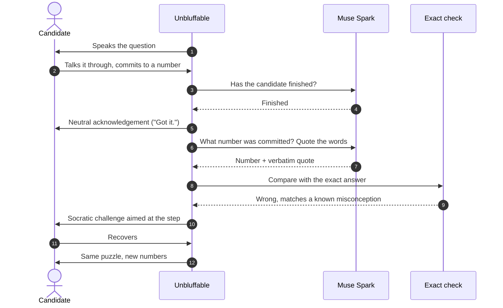

<div align="center">

# Unbluffable

### Sounding right isn't the same as being right.

A spoken mock interviewer that hears your answer, quotes your words back,<br/>
checks your numbers exactly and pushes back like a real interviewer,<br/>
so anyone can know what the room feels like before they're in it.


[How it works](#how-it-works) · [Meta models](#meta-models-and-their-roles) · [Measured so far](#measured-so-far) · [Run it](#run-it-locally) · [Decision log](spec/DECISION_LOG.md)

</div>

---

> [!NOTE]
> **Status, 31 Oct 2026.** The hands-free voice interview, exact checking, Bayesian scoring, diagnostic twins, the live evidence meter, receipts, drill mode, behavioural questions, the readiness profile and the end-of-interview report work end to end in tests. Four tracks run on cross-checked question families: quant, investment banking, consulting and software engineering. In progress: a measured comparison against a carefully prompted chatbot ([What's next](#whats-next)). Results appear here only once they are measured.

## Why

I struggled in interviews. Not because I didn't know the material, but because I'd never been in the room: never had someone stop me mid-answer, question the number I'd just committed to, and ask it again with different numbers.

Some candidates get that practice through coaches, paid prep or people who've been through it. Most don't. They walk into their first real interview to find out what one is like.

I started building this for quant interviews, my own field. But the problem isn't quant. Banking, consulting and software interviews work the same way: you think out loud, commit to an answer, and get pushed on it. Quant, investment banking, consulting and software engineering are all live.

**It's the interviewer you'd have if you had the connections.** Built for the theme **Build for Your World**.

## What it does

| | |
| --- | --- |
| **Four tracks** | Quant, investment banking, consulting and software engineering, each with its own topics and the same interviewer. |
| **Behavioural questions** | For banking and consulting: "tell me about a time…" and "what would you do if…". Your STAR funnel is filled with your own quoted words, the interviewer probes the weakest step, and your follow-up is checked against your first telling. Model-judged, and labelled that way. |
| **Hands-free spoken interview** | One tap starts it. The interviewer speaks, you talk it through, and the app decides you've finished from what you said, not from a fixed pause. A silence prompt and an optional Done button are fallbacks. Camera and microphone are on, as in a real interview; a typed practice mode is there for anyone who can't use them, labelled *not exam conditions*. |
| **Exact checking** | The model extracts the answer you committed to and quotes your own words. Every number is checked with exact fractions in code, never by a model. |
| **Socratic challenge** | A committed wrong answer gets a question that points at the step, not the solution. Nudges and hints are allowed, and the score counts the help it took. |
| **Same puzzle, new numbers** | A second version with different numbers separates someone who worked it out from someone who remembered an answer. |
| **Numbers chosen to expose your mistake** | When the interviewer suspects a specific mistake, it picks the new numbers where that mistake gives a clearly different answer from the right method, and says why these numbers. |
| **Live evidence meter** | The Sound / Misconception / Gap estimate updates after every scored answer, with one line on what the next answer would change. |
| **Receipts** | Every challenge and every report line opens to show your exact words beside the exact computation: the value read, the check, and the known wrong methods. |
| **Drill this mistake** | From the report, a short drill aims new questions at a detected misconception, asks questions only, then checks with fresh numbers: *Cleared* or *Still showing*. |
| **Evidence-based scoring** | A Bayesian engine weighs each final answer, discounted by the help used, and stops when the evidence is clear: *Evidence supports understanding*, *Misconception detected*, *Understanding not shown* or *More evidence needed*. |
| **In-app report** | A headline label, one tab per question, your quoted words beside the exact value, the help taken and time against the guide. |
| **Which model did what** | Every turn shows which model ran, for which job, with latency and cost. |
| **Privacy** | Audio and video are never saved; answer text is kept only with consent. The camera self-view stays on this device: never recorded, uploaded or sent to a model. |

## How it works


<sub>Purple: people · Blue: Meta models · Green: our code</sub>

One answer, start to finish:



- **Turn-taking.** After a short pause, deterministic cues decide first ("that's my answer", a trailing "so…"), and only unclear cases go to the model. If you go quiet for about 8 s, a fast check ends the turn if you've committed to a number, and otherwise asks you to talk it through.
- **Help accounting.** Each hint or nudge is scored by how many solution steps it gives away beyond where you already were (help load H). A correct answer after help counts for less: its evidence weight is w = 2 / (2 + H), and needing a challenge counts as one more step ([spec/02 §7](spec/02_ENGINE_SPEC.md)).
- **No model grades a number.** Models extract and phrase; code computes. A quote is kept only if it appears word for word in your transcript.

## Meta models and their roles

| Model | Runs on | Job |
| --- | --- | --- |
| **Muse Voice Transcribe** · `muse-voice-transcribe-1.0` | Meta Model API, realtime | Live speech-to-text for the hands-free interview |
| **Muse Spark** · `muse-spark-1.3` | Meta Model API | Extracts the committed answer and verbatim quotes, judges whether an answer is finished, judges behavioural answers (local runs) |
| **Muse Spark Open** · `muse-spark-open-1026` | Baseten (open weights) | Every reasoning call on the hosted app, including judging behavioural answers. Offline, it wrote an independent solver and wrong-method programs for every question family; only families whose solver reproduced every stored answer were shipped |
| **Exact maths** | Our code | Every number check and every score |

### Why open weights

From our cloud host, Meta's API showed no Muse Spark models for our key: `GET /v1/models` returned HTTP 200 with an empty list, while the same key from a UK connection listed 9 models. Moving every reasoning call on the hosted app to Muse Spark Open kept it deployable. Transcription stays on Muse Voice Transcribe.

| 10-case latency probe | Median | Max | Same commitment and number as Muse Spark |
| --- | --- | --- | --- |
| Muse Spark, minimal effort | 0.98 s | 1.90 s | — |
| Muse Spark Open (Baseten) | 1.59 s | 3.95 s | **10 / 10** |

## Measured so far

| What | Result |
| --- | --- |
| **Interrupting mid-sentence** with realtime keyword rules | 2/10 wrong answers caught on the first gate. Rules widened from the failure types reached 8/10 on those clips but **1/10 on 30 new held-out clips**, with 0/20 false challenges in both runs. We dropped it for a challenge right after the answer ([decision log](spec/DECISION_LOG.md) rows 1–1b). |
| **End-of-answer detection** on 60 recorded clips | **0 early cut-offs.** 32/60 completed exactly once; every miss was the app waiting too long, never interrupting. A silence check was added afterwards (rows 11–12). |
| **Last word to spoken acknowledgement** | About 2 s in a timed run, most of it one Muse Spark call |
| **Question families cross-checked** | **248** families across four tracks (129 quant, 119 investment banking, consulting and software engineering): for each one, Muse Spark Open wrote an independent solver, and it reproduced the stored answer on every variant. **0 disagreements.** 203 families also have wrong-method values verified in code, which the interviewer uses to name a misconception. |
| **Automated tests** | 900+ (pytest), including pinned values for the engine maths, plus browser checks across phone and laptop widths in light and dark |

Every change from the original plan is in the [decision log](spec/DECISION_LOG.md), with the evidence that forced it, including what failed.

## What's next

> [!IMPORTANT]
> In progress. None of this is claimed as a result yet.

- **Careful-chatbot comparison.** A pre-registered test on frozen answers: plain Muse Spark, carefully prompted Muse Spark, carefully prompted Muse Spark given the answer key, and Unbluffable, all on the same model, three runs each.
- **Real users** from a university quant society, with consent.

## Run it locally

**Needs:** Python 3.12, ffmpeg (for uploaded audio files) and a Meta Model API key.

```bash
python -m venv .venv
.venv/bin/pip install -e ".[dev]"
export MODEL_API_KEY=...
.venv/bin/python -m uvicorn app.main:app --port 8000
```

<details>
<summary>Windows PowerShell</summary>

```powershell
python -m venv .venv
.venv\Scripts\pip install -e ".[dev]"
$env:MODEL_API_KEY = "..."
.venv\Scripts\python -m uvicorn app.main:app --port 8000
```

</details>

Open **http://localhost:8000/ui** and start an interview. Wear headphones if you want to talk over the interviewer; without them the mic is muted while it speaks.

| Option | How |
| --- | --- |
| All reasoning calls on Muse Spark Open | Set `LLM_BACKEND=open_weights` and `BASETEN_API_KEY` |
| Run the tests (no key needed, uses fakes) | `.venv/bin/python -m pytest -q` |
| Docker | `docker build -t unbluffable .` then `docker run -p 8000:8000 -e MODEL_API_KEY=... unbluffable` |

## Repository

| Path | Contents |
| --- | --- |
| `app/` | FastAPI server, Exam Room interview, report, voice routes |
| `engine/` | Puzzle templates, exact checking, Bayesian engine, help discount |
| `llm/` | Model clients (Meta Model API and open weights), structured extraction, record/replay |
| `voice/` | Realtime transcription relay, end-of-answer detection |
| `content/` | Likelihood tables |
| `docs/` | Measured capability sheet for the Meta APIs |
| `spec/` | The plan written before kickoff, and the decision log |
| `scripts/` | Latency probes and the turn-taking gate harness |
| `tests/` | Automated tests |

## Disclosures and limits

- **Prior work.** The specification in `spec/` was written before kickoff as a plan. All code was written after kickoff on 26 Oct 2026, and the commit history shows it. Built with AI coding assistants (Claude Code, Codex, Muse Code).
- **Question sets.** The quant, investment banking, consulting and software engineering question sets were generated by the builder with ChatGPT during the hackathon (30 Oct 2026).
- **Behavioural questions.** The 40 behavioural questions (with their answer signals, pitfalls and probes) were written with Claude during the hackathon (30 Oct 2026). Behavioural answers are judged by Muse Spark, labelled "model-judged, not exact", and never feed the readiness rating or the label. Their answers are re-checked in code as described above; ChatGPT is not used by the running app.
- **Probabilities are model estimates.** The engine's likelihoods are stated assumptions (`content/likelihoods.yaml`), not calibrated measurements.
- **Turn-taking can wait too long.** When it does, the silence prompt or the Done button moves things on.
- **Interview practice, not a tutor or a hiring tool.** It's built for candidates to practise.
