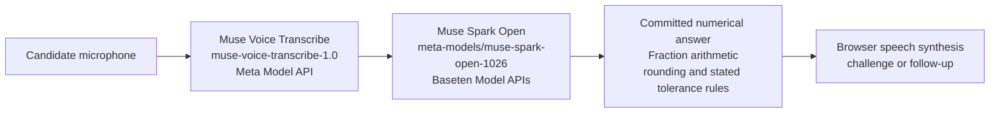

# Meta integration evidence

Unbluffable uses Meta speech recognition and Meta reasoning models, with deterministic numerical checking in application code.

## Hosted interview pipeline

The model interprets the transcript and reasoning. Code checks the extracted committed numerical answer. Behavioural and conceptual judgments are model-based. The spoken interviewer uses the browser's speech synthesis.

## Integration locations

| Integration | Provider / endpoint | Implementation | Verification coverage |
|---|---|---|---|
| Muse Voice Transcribe, `muse-voice-transcribe-1.0` | Meta Model API, `wss://api.meta.ai/v1/asr/realtime` and file transcription under `https://api.meta.ai/v1` | [Voice provider](../voice/provider.py), [server relay](../voice/relay.py), [voice routes](../app/voice_routes.py) | [Provider tests](../tests/test_voice_provider.py), [relay tests](../tests/test_voice_relay.py), [route tests](../tests/test_voice_routes.py) |
| Muse Spark Open, `meta-models/muse-spark-open-1026` | Baseten Model APIs, `https://inference.baseten.co/v1` | [Model identifiers and clients](../llm/client.py), [OpenWeightsBackend](../llm/backends.py), [voice provider](../voice/provider.py) | [Open-weight backend tests](../tests/test_llm_open_weights.py), [voice backend tests](../tests/test_voice_backends.py) |
| Muse Spark 1.3, `muse-spark-1.3` | Meta Model API, `https://api.meta.ai/v1` | [MetaAPIBackend](../llm/backends.py), [structured extraction](../llm/extract.py) | [Extraction tests](../tests/test_llm_extraction.py), [scoring tests](../tests/test_llm_scoring.py) |
| Numeric check | Local application code | [Fraction checker](../engine/checker.py), [answer outcomes](../engine/coding.py), [question bank and diagnostic twins](../engine/bank.py) | [Pinned engine tests](../tests/test_engine_pinned.py), [coding tests](../tests/test_engine_coding.py), [wrong-value tests](../tests/test_wrong_values.py) |

Set `LLM_BACKEND=open_weights` to select Muse Spark Open on Baseten. Set `LLM_BACKEND=meta_api` to select Muse Spark 1.3 on the Meta Model API. These are alternative reasoning backends. Transcription remains on Muse Voice Transcribe.

The hosted configuration described in the README uses the open-weight backend. Offline, Muse Spark Open also wrote the shipped question families' solvers and wrong-method computations; the family forge checked their results against the stored answers across the variants.

Using open-weight inference does not imply that Unbluffable trained or fine-tuned a model. The model checks use fakes and recorded responses where appropriate; a passing test does not by itself establish a successful live provider call. See the [README measurements and disclosures](../README.md#measured-so-far) for the recorded live evidence and limitations.

## Demonstrating the integrations

Record a real spoken numeric interview. Show the live transcript, the model panel identifying the actual reasoning backend and transcription model, the exact-answer receipt, and the same puzzle with changed numbers. Keep model keys and authorization values out of footage.

Use actual model-panel timings as per-call measurements. End-to-end response time also includes turn completion, model calls and speech startup; it must be measured separately.
